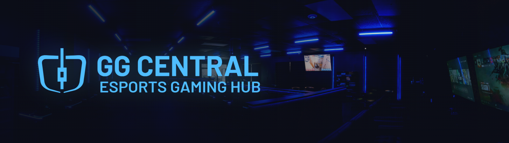

  
 
**The tech behind Waterloo's esports gaming hub.**
 

 

---

## Who we are
 
GG Central is a gaming cafe and lounge at **354 King St N, Waterloo**, steps from the University of Waterloo, Wilfrid Laurier, and Conestoga College. Players come in for high-end PCs, consoles, board games, snacks, and a good vibe.
 
This organization holds the software and infrastructure we build in-house to run the venue.

## Projects
 
| Project | What it does |
|---|---|
| [**ggLight**](https://github.com/GG-Central/ggLight) | Web dashboard for DMX RGB LED lighting. Control a whole row of light bars from a browser with quick colors, per-bar control, built-in effects, and an opening-hours schedule. Runs on Node.js with a USB-DMX cable. |

### Coming soon
 
| Project | What it does |
|---|---|
| **ggPOS** | A point-of-sale system made for gaming cafes, with built-in paywalling for PS5 consoles. |
| **ggConsole** | PS5 session control on a Raspberry Pi 4/5. Switches TV inputs through a custom HDMI smart switch to lock and unlock consoles. Works with ggPOS or any other POS system. |

Watch this org to catch new releases.

## Built for real-world use
 
Our tools are developed and tested on a live setup:
 
- **20 custom-built gaming PCs**, running all day with real players
- **Diskless, PXE network boot** from a central server
- **Custom networking** with an in-house server rack
If it works through a Friday night rush at our place, it'll def work at yours.

---

  Made in Waterloo, Ontario 🇨🇦 by <b>GG Central - Esports Gaming Hub</b>

